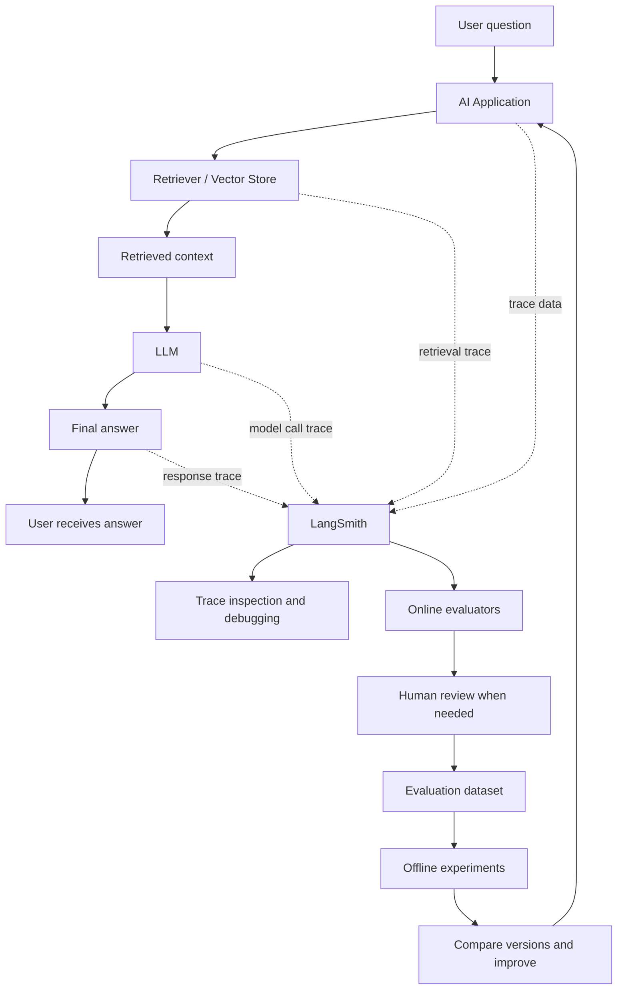
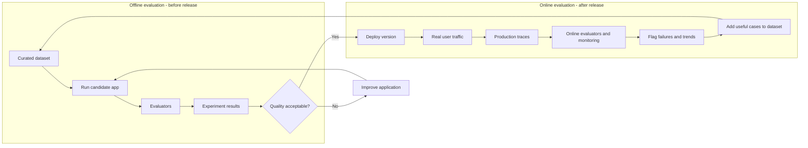
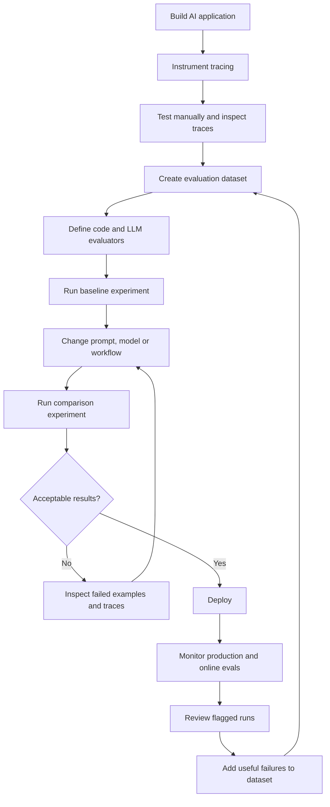

# AI Evaluation

## 1. Introduction

AI evaluation is the process of measuring how well an AI system performs
against defined quality criteria. It helps teams understand whether a
system is accurate, useful, reliable, and suitable for its intended use.

For applications that use Retrieval-Augmented Generation (RAG),
evaluation should distinguish between two important stages:

-   **Retrieval quality:** Did the system retrieve the information
    needed to answer the question?
-   **Generation quality:** Did the model produce a correct, relevant
    answer based on the available information?

Evaluating these stages separately makes it easier to identify the
source of a failure and decide what needs to be improved.

Evaluation is different from tracing. **Tracing records what happened
during execution; evaluation measures how well the system performed.**

## 2. Main Evaluation Approaches

There are three commonly used approaches:

1.  **Code-based evaluation:** Uses deterministic rules, calculations,
    and comparisons to measure objective properties.
2.  **LLM-as-a-Judge:** Uses a language model to assess qualities that
    are difficult to measure with fixed rules.
3.  **Human review:** Uses human judgment to assess output quality,
    investigate edge cases, and validate automated evaluators.

These approaches complement one another. A robust evaluation process
often combines all three.

## 3. Code-Based Evaluation

Code-based evaluators use predefined logic to check an AI system's
output. They are generally deterministic: the same input produces the
same evaluation result.

They work best when the expected behaviour can be expressed as a clear
rule or measurable condition.

| Evaluation type        | What it measures                                      | Example use case |
|------------------------|-------------------------------------------------------|------------------|
| Exact match            | Whether the generated output exactly matches the expected output | Checking whether a classifier returns the expected category |
| Normalized exact match | Whether outputs match after basic normalization, such as ignoring case, extra spaces, or punctuation | Treating `Approved` and `approved` as equivalent |
| String similarity      | How similar two text strings are, often using edit distance such as Levenshtein distance | Detecting small spelling or wording differences in a short generated field |
| Semantic similarity    | Whether two pieces of text have similar meaning, commonly using embeddings | Comparing two differently worded summaries that express the same idea |
| Keyword coverage       | Whether required terms or phrases are present | Checking whether a generated response includes required product features |
| Numerical fact check   | Whether expected numerical values appear in the output | Verifying that a generated calculation includes the expected total |
| Source validation      | Whether the expected source or document was retrieved or referenced | Checking that a question about a contract is supported by the relevant contract document |
| Abstention check       | Whether the system appropriately declines to answer when sufficient information is unavailable | Verifying that a support assistant does not invent an answer when its knowledge base has no relevant information |

### Strengths and limitations

Code-based evaluation is fast, repeatable, explainable, and usually
inexpensive to run. It is particularly useful for structured outputs,
fixed rules, numerical values, required fields, and regression checks.

However, it does not inherently understand context or meaning. A keyword
may appear in an answer even when the answer is incorrect. Likewise, two
valid answers may use different wording and fail an exact-match check.

Use code-based checks for objective conditions, and complement them with
semantic evaluation when meaning and context matter.

## 4. Evaluation of RAG Retrieval Quality

RAG systems retrieve information before generating an answer. Retrieval
metrics help determine whether the retrieved content is relevant and
sufficiently complete.

### Context Precision

Context Precision measures how much of the retrieved information is
relevant to the user's question. It also considers the order of
retrieved results: relevant information appearing higher in the ranking
is generally more useful.

**Example:** For a question about a product's warranty period, the
retriever should prioritize warranty information rather than unrelated
product specifications or shipping details.

### Context Recall

Context Recall measures whether the retrieved information contains the
facts needed to answer the question.

**Example:** If answering a question requires both a warranty duration
and an eligibility condition, the retrieved context should contain both
facts.

The distinction is:

-   **Precision:** How much of what was retrieved is relevant?
-   **Recall:** How much of the required information was retrieved?

These metrics can be implemented with simple rules for straightforward
cases, but semantic and long-context evaluation often benefits from an
LLM judge.

## 5. LLM-as-a-Judge

LLM-as-a-Judge is an evaluation approach in which a language model
assesses another AI system's output. The judge receives relevant
information---such as the question, generated answer, retrieved context,
or reference answer---and evaluates it using defined criteria.

It is useful for assessing meaning, relevance, completeness, and factual
support when deterministic rules are insufficient.

### Common LLM-judge metrics

| Metric             | What it evaluates                                      | Example |
|--------------------|--------------------------------------------------------|---------|
| Answer Relevance   | Whether the answer addresses the user's question       | A user asks for troubleshooting steps, but the response only describes the product |
| Faithfulness       | Whether the answer's claims are supported by the provided context | A document states that a service is available in two regions, but the answer claims it is available in five |
| Answer Correctness | Whether the answer is factually correct compared with a verified reference answer | The reference states that a device supports Wi-Fi 6, but the generated answer says Wi-Fi 5 |
| Context Precision  | Whether retrieved chunks are relevant to the question, taking their ranking into account | Relevant troubleshooting instructions should rank above unrelated documentation |
| Context Recall     | Whether the retrieved context contains the information required to answer the question | The retrieved material should include all conditions needed to answer a policy question |

These metrics measure different aspects of quality. An answer can be
relevant to a question but still contain unsupported or incorrect
information.

### Designing a reliable judge

An LLM judge should be given:

-   A clearly defined evaluation objective.
-   A consistent scoring rubric, including what each score represents.
-   The appropriate input data, such as the question, context, and
    reference answer.
-   A structured output format, such as a score, decision, and
    explanation.

Structured outputs make evaluation results easier to validate,
aggregate, compare, and store.

### Limitations and reliability

LLM judges can make mistakes. Their results may vary with the judge
model, prompt wording, scoring rubric, or order and presentation of
information. They may also favour longer or more confidently worded
answers.

Judge reliability should be checked using human-reviewed examples. Teams
should inspect disagreements, refine rubrics, and periodically validate
the judge rather than treating its score as ground truth.

## 6. Human Review

Human review involves people inspecting AI outputs and deciding whether
they meet the required quality standards.

It is valuable when:

-   The task requires domain expertise or nuanced judgment.
-   An automated evaluator produces an unexpected result.
-   The output could have a significant impact on a user or business
    decision.
-   Evaluation criteria are subjective or still being refined.
-   Automated evaluators need to be validated.

**Example:** An automated evaluator may mark a customer-support response
as correct because it includes the right troubleshooting steps. A human
reviewer may notice that the instructions are confusing, omit an
important warning, or are unsuitable for the customer's situation.

Human review can also be used to create trusted reference labels and
measure how closely automated evaluators agree with human judgments.

## 7. Evaluation Datasets and Experiments

An evaluation dataset is a collection of representative test cases used
to measure system quality. Each test case commonly contains:

-   **Input:** The question, prompt, or task given to the AI system.
-   **Output:** The response produced by the system.
-   **Reference:** A verified expected answer or other ground-truth
    information, when available.

A useful dataset should include normal scenarios, edge cases, ambiguous
inputs, and cases where the system should decline to answer. It should
reflect the range of situations the application is expected to handle.

Evaluation experiments run a system against a dataset and apply selected
evaluators to its outputs. Results can be compared across model
versions, prompts, retrieval configurations, or application changes.
This helps identify regressions and determine whether a change improves
quality.

## 8. Evaluating AI Agents

For an AI agent, evaluating only the final answer may not be sufficient.
An agent can produce a plausible response while making poor intermediate
decisions or using tools incorrectly.

Agent evaluation can include:

| Evaluation target        | What to check |
|--------------------------|---------------|
| Retrieval                | Was the relevant information retrieved? |
| Routing                  | Did the agent choose the appropriate workflow or next step? |
| Tool selection           | Did it select the correct tool for the task? |
| Tool execution           | Did it provide valid inputs and use the tool result correctly? |
| Intermediate decisions   | Were the observable decisions appropriate for the task and available information? |
| Execution trajectory     | Did the agent follow an appropriate sequence of steps? |
| Final answer             | Was the response relevant, faithful, and correct? |

Code-based checks can validate expected tool calls, arguments, and
workflow constraints. LLM judges and human reviewers can assess more
nuanced decisions and the overall quality of the execution.

## 9. Further Areas in AI Evaluation

A mature evaluation process may also cover:

-   **Regression evaluation:** Re-running established test cases after
    changes to detect quality drops.
-   **Failure analysis:** Grouping failed cases by cause, such as
    retrieval errors, unsupported claims, or incorrect tool use.
-   **Evaluator calibration:** Checking whether evaluator scores
    correspond to consistent quality levels and human judgments.
-   **Cost and latency:** Measuring the financial and time cost of
    producing responses.
-   **Continuous evaluation:** Running evaluations regularly as part of
    development and release workflows.
-   **Version comparison:** Comparing models, prompts, datasets, and
    system configurations using consistent test cases.
-   **Evaluation tracking:** Using platforms such as LangSmith to manage
    datasets, record traces, run experiments, connect custom evaluators,
    and compare results.

## 10. Summary

A good AI evaluation strategy measures different aspects of system
quality rather than relying on a single score.

-   Use **code-based evaluation** for objective, deterministic, and
    repeatable checks.
-   Use **LLM-as-a-Judge** for semantic, contextual, and more nuanced
    assessments.
-   Use **human review** to validate outputs, investigate difficult
    cases, and assess evaluator reliability.
-   For **RAG systems**, evaluate retrieval quality separately from
    answer quality.
-   For **AI agents**, evaluate tool usage, routing, execution steps,
    and final responses---not just the final answer.

The choice of metrics should depend on the application's purpose, risks,
and expected behaviour. Evaluation is most useful when datasets and
criteria are maintained over time and results are used to guide
improvements.

---

## 11. How Evaluation Fits into a Real AI Project

Consider a customer-support RAG assistant. A user asks a question about a product, the application retrieves relevant documents, and an LLM generates an answer.

Evaluation is not a separate step that happens only at the end. It can be used throughout development and after deployment.

### High-level architecture

<caption>The application runs independently. LangSmith receives trace information and provides tools to inspect, evaluate and improve the application.</caption>

### What happens in this architecture?

1. **User submits a question:** The application receives the user's input.
2. **Retrieval:** The retriever searches the knowledge base for relevant content.
3. **Generation:** The LLM uses the question and retrieved context to generate a response.
4. **Tracing:** The application records information about the execution, such as inputs, outputs, retrieval results, model calls, tool calls, latency and errors (depending on instrumentation and configuration).
5. **Evaluation:** Evaluators score the run. Some checks can be automatic, and others can be sent to human reviewers.
6. **Improvement:** Failed or interesting examples can be added to a dataset and reused to test future versions.

## 12. Example: Using Evaluation in a Customer-Support RAG Project

Imagine a company has a support assistant that answers questions about product documentation.

### Step 1: Build a test dataset

Before changing prompts or models, create a small set of realistic questions. Grow it over time.

| Question | Reference / expected information |
|---|---|
| How long is the product warranty? | Warranty is 2 years. |
| Can I replace the battery myself? | The documentation says replacement is user-serviceable. |
| Does the product support Wi-Fi 6? | Yes, Wi-Fi 6 is supported. |
| How do I reset the device? | The answer should include the documented reset steps. |
| What is the warranty for a product not listed in the documents? | The assistant should clearly say it cannot find reliable information. |

The reference information does not have to be a complete sentence that the AI must reproduce word-for-word. For semantic evaluation, it can be the verified facts or criteria that a good answer should satisfy.

### Step 2: Choose evaluators

Use multiple evaluators because one score cannot capture every aspect of quality.

| Evaluator | Example check |
|---|---|
| Code-based | Did the response contain valid JSON (if JSON is required)? |
| Code-based | Were required fields present? |
| Retrieval evaluation | Did the retrieved documents contain the warranty information? |
| LLM-as-a-Judge | Did the answer correctly and completely answer the question? |
| LLM-as-a-Judge | Are the claims supported by the retrieved documents? |
| Human review | Is the response useful, understandable and appropriate? |

### Step 3: Run an experiment

Suppose you are comparing two versions of the assistant:

- **Version A:** Original prompt and retriever configuration.
- **Version B:** Improved prompt and a different chunking or retrieval configuration.

Run both versions against the same dataset, using the same evaluators where possible. The experiment results help compare quality, latency, errors and cost.

### Step 4: Analyze failures rather than only looking at average scores

For example:

| Test case | Version A | Version B | What to investigate |
|---|---|---|---|
| Warranty question | Pass | Pass | No change needed |
| Battery replacement | Fail | Pass | Did retrieval improve? |
| Wi-Fi 6 question | Pass | Fail | Inspect retrieved context and prompt |
| Unknown product | Fail (invented answer) | Pass (abstained) | Check abstention behavior |

An average score might hide the Wi-Fi 6 regression. Inspect individual examples and traces to understand why a version failed.

### Step 5: Improve and repeat

Use the failure analysis to change the prompt, retrieval strategy, model, tool logic or application code. Run the dataset again and compare results.

This cycle is the practical use of evaluation: **make a change, measure it, inspect failures, and repeat.**

## 13. Offline Evaluation vs. Online Evaluation

Evaluation is commonly used at two different stages.

### Offline evaluation

Offline evaluation runs a candidate application against a controlled dataset.

**Typical uses:**

- Testing a prompt change.
- Comparing LLM providers or models.
- Testing new chunking, embeddings or retrieval settings.
- Regression testing before release.
- Benchmarking an agent's tool selection or workflow.

### Online evaluation

Online evaluation evaluates actual application runs or user interactions after deployment. It often does not have a reference answer for every interaction.

**Typical uses:**

- Detecting potentially unsupported answers.
- Monitoring response quality trends.
- Identifying unusual responses or failures.
- Monitoring latency, token usage or other operational signals.
- Finding real-world examples that should be added to offline datasets.

Online evaluation does not replace offline evaluation. They complement each other.

## 14. What LangSmith Offers

LangSmith is a platform for developing, testing, debugging and monitoring LLM applications and agents. It can be used with LangChain and LangGraph, but it is also framework-agnostic.

### 14.1 Tracing and observability

Tracing captures the execution of your application so that you can investigate what happened.

A trace can show:

- User inputs and application outputs.
- LLM calls, prompts and model responses.
- Retrieval steps and retrieved documents, when instrumented.
- Tool calls, tool inputs and tool outputs.
- Workflow steps and execution structure.
- Errors, durations and other recorded metadata.

**Why it matters:** If the assistant gives a wrong answer, you can inspect the trace to see whether retrieval was poor, the model misunderstood the context, a tool failed, or the application logic behaved incorrectly.

### 14.2 Datasets

Datasets store examples that can be reused to test an application.

A dataset may contain:

- Input questions or tasks.
- Reference outputs, expected facts or other evaluation targets.
- Metadata useful for organizing test cases.

Examples can be manually created or collected from application traces and refined.

**Why it matters:** A failure you discovered once can become a repeatable test rather than being forgotten.

### 14.3 Evaluators

LangSmith supports different approaches to evaluation, including:

- **Code evaluators:** Custom deterministic logic.
- **LLM-as-a-Judge:** Model-based scoring using defined criteria.
- **Human evaluation:** Review and feedback through annotation workflows.
- **Custom evaluators:** Your own scoring logic.
- **Composite or combined evaluations:** Combining evaluation criteria where appropriate.

**Why it matters:** You can combine objective checks with semantic judgments rather than depending on a single evaluator.

### 14.4 Experiments and comparison

An experiment records how a particular application version performs on a dataset.

You can compare experiments across changes such as:

- Prompt versions.
- Models or model providers.
- Retrieval configurations.
- Application code or workflow changes.
- Evaluator configurations.

Results can include individual example outputs, scores, traces and aggregate metrics.

**Why it matters:** It makes it easier to see whether a change actually improved performance or introduced a regression.

### 14.5 Human feedback and annotation queues

Human reviewers can inspect selected application runs and score or annotate them.

This is useful for:

- Reviewing difficult or high-impact cases.
- Validating LLM-as-a-Judge results.
- Identifying recurring failure patterns.
- Creating better evaluation examples.
- Establishing trusted labels for evaluator calibration.

### 14.6 Production monitoring and online evaluations

LangSmith can be used to monitor production traces and run online evaluations.

Teams can use these capabilities to:

- Score live interactions.
- Detect possible quality issues.
- Filter and inspect traces.
- Identify trends and failures.
- Send selected runs for human review.

### 14.7 Prompt experimentation

Prompt-related tools can help teams iterate on instructions, compare prompt variants, and test changes against evaluation examples.

**Why it matters:** Prompt changes should be measured on a dataset instead of relying only on a few manual examples.

### 14.8 Debugging and analysis

Trace inspection and experiment analysis help developers investigate individual failures and patterns across many runs.

Instead of asking only, "Did the AI answer correctly?", you can investigate:

- What context did it receive?
- Which tools did it use?
- What inputs were sent to those tools?
- Where did the workflow fail?
- Which test cases are consistently failing?
- Did a change increase latency or cost?

### 14.9 CI/CD integration

Evaluation can be integrated into automated development workflows, for example:

1. A developer opens a pull request.
2. Automated tests and a selected evaluation dataset run.
3. Evaluators produce scores.
4. The team compares the results against thresholds or a baseline.
5. The pipeline can flag or block a release if critical checks fail.

For example, a team might require all structured-output checks to pass and prevent a release if faithfulness or answer correctness drops beyond an agreed threshold. Thresholds should be calibrated for the task and evaluator reliability rather than chosen arbitrarily.

## 15. A Practical AI Evaluation Development Workflow

### Recommended order for a beginner project

1. **Start with tracing.** Make the application's execution visible.
2. **Create a small dataset.** Start with 10–20 realistic examples, then expand based on observed failures and coverage needs.
3. **Add code-based evaluators.** Check output formats, required fields, fixed rules and expected tool usage.
4. **Add LLM judges.** Evaluate relevance, faithfulness, correctness and completeness where deterministic checks are insufficient.
5. **Run experiments.** Test your changes against the same dataset.
6. **Review failed cases.** Inspect traces, retrieved context and evaluator explanations.
7. **Deploy and monitor.** Use online evaluations to identify issues in actual traffic.
8. **Keep improving the dataset.** Add important real-world failures to your regression tests.

---

## 16. Key Takeaway

AI evaluation is not simply a way to assign a score to an AI response. It is a feedback loop used to improve an application over time.

- **Tracing** helps you see what happened.
- **Evaluation** helps you measure how well it happened.
- **Datasets** help you test consistently.
- **Experiments** help you compare changes.
- **Human review** helps validate automated evaluation.
- **Production monitoring** helps you discover failures in real usage.
- **Regression testing** helps ensure that fixes and improvements do not break previously working cases.

LangSmith brings many of these activities into one platform, helping teams move from manually testing a few prompts to a repeatable process of testing, debugging, evaluating and monitoring AI applications.
