# System Architecture & Design

This document explains how our **RAG Application** and **Autonomous Agent** are designed and how data moves through the system.

---

## 💡 Key Terms Explained Simply

- **RAG (Retrieval-Augmented Generation):** Instead of asking the AI to guess or remember company policies from its training data, we look up (*retrieve*) the exact company document first, paste it into the prompt (*augment*), and tell the AI to answer using only that document (*generate*).
- **Embeddings:** Converting sentences into lists of numbers (vectors). Text chunks with similar meanings end up with similar numbers, allowing us to search by meaning rather than exact keywords.
- **Vector Database (ChromaDB):** A specialized database that stores text embeddings so we can find the most relevant document chunks in milliseconds.
- **Chunking:** Splitting long policy documents into smaller pieces (e.g. 500 characters) so they fit nicely into the LLM prompt.
- **Agent:** An LLM wrapped in a loop with tools. Unlike a standard chatbot that just answers, an agent can think, decide *which tool to use*, check if its own findings are good enough, or escalate to a human.

---

## 1. High-Level System Flow

```mermaid
flowchart TD
    subgraph 1. Knowledge Base Preparation
        Docs[15 Company Policies in data/documents/] --> Chunk[Split into 500-char Chunks]
        Chunk --> Hash[Deterministic Chunk IDs: doc_name_c001_hash]
        Hash --> Chroma[(ChromaDB Vector Store)]
    end

    subgraph 2. Answering User Questions
        UserQuery[Employee Question] --> Choice{How are we running?}
        
        Choice -->|Simple Chatbot| DirectRAG[Standard RAG: src/rag/pipeline.py]
        DirectRAG --> SearchChroma[Search ChromaDB for Top-3 Chunks]
        SearchChroma --> LLMAnswer[Gemini 3.5 Flash Generates Answer]
        
        Choice -->|Smart Agent| AgentGraph[LangGraph Agent: src/agent/graph.py]
        AgentGraph --> Router[Router Node: Classifies Question Intent]
        Router -->|Policy Question| ToolSearch[Policy Search Tool]
        ToolSearch --> SearchChroma
        SearchChroma --> Sufficiency[Context Sufficiency Node]
        Sufficiency -->|Enough Info| LLMAnswer
        Sufficiency -->|Missing Info| EscalateNode[Escalation Node: Returns HR Contact]
        Router -->|Dispute / Bug| EscalateNode
    end
```

---

## 2. Where Does Each Part Live?

| Step | What it does | File path |
|---|---|---|
| **Loading & Splitting** | Reads text files and creates deterministic IDs to avoid duplicate records | [`src/ingestion/loader.py`](file:///Users/shubham/Projects/rag-agent-evaluation/src/ingestion/loader.py) |
| **Vector Storage** | Saves chunks into ChromaDB with embeddings | [`src/retrieval/vector_store.py`](file:///Users/shubham/Projects/rag-agent-evaluation/src/retrieval/vector_store.py) |
| **Searching Documents** | Finds the top $k$ most relevant chunks for a question | [`src/retrieval/retriever.py`](file:///Users/shubham/Projects/rag-agent-evaluation/src/retrieval/retriever.py) |
| **Direct RAG Chain** | Combines retrieved text with the prompt to generate an answer | [`src/rag/pipeline.py`](file:///Users/shubham/Projects/rag-agent-evaluation/src/rag/pipeline.py) |
| **Agent Logic** | Multi-step decision making (LangGraph) | [`src/agent/graph.py`](file:///Users/shubham/Projects/rag-agent-evaluation/src/agent/graph.py) |
| **Agent Tools** | Functions the agent can call (search policies, directory) | [`src/tools/policy_tools.py`](file:///Users/shubham/Projects/rag-agent-evaluation/src/tools/policy_tools.py) |

---

## 3. Why Deterministic Chunk IDs Matter
If you index documents twice, many basic vector database setups create duplicate records.
In our loader ([`src/ingestion/loader.py`](file:///Users/shubham/Projects/rag-agent-evaluation/src/ingestion/loader.py)), we generate stable IDs like:
`leave_policy.txt_c001_a9f1b2`

When re-indexing, ChromaDB checks if that ID already exists. If yes, it skips it. No duplicates, no wasted memory!
